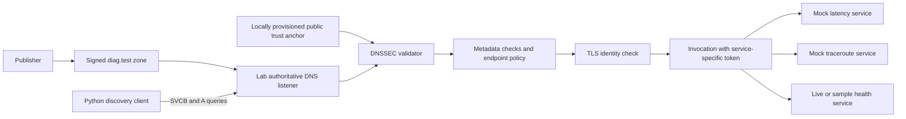

# AIORI-3 / PS-033: DNS-Based Discovery of Diagnostic Services

**Team code and required GitHub repository name: `A3-PS033-TC378`.**

**Students:** Chris Itty Biju and Alan Jayan Joseph. **Faculty mentor:** Revathi BS.
**Institution:** Karunya University of Technology and Sciences.

For the 14 October Level 1 deadline, begin with
[the submission guide](level-1-submission/START-HERE.md). The same folder contains
the presentation, editable slides, team video script and repository README draft.

A working local starter for the team's hackathon project. Two students and one
faculty mentor. Working project name: **DiagDiscover** (optional branding).

The interface runs actual local DNS, DNSSEC, TLS and authenticated HTTP checks.
Live health mode measures CPU, memory and uptime on the diagnostic service's
host. All sample data mode preserves the three mock services required by PS-033.
The signed DNS catalogue lists published entries without invoking services.
This is a bounded local prototype; it is not an internet-wide diagnostic registry
or a production DNS deployment. See [the operating notes](docs/OPERATIONS.md).

## The problem in plain language

A diagnostic client often has the address of a latency or traceroute service
written into its configuration. When that endpoint moves, the client breaks.
Here the client knows a logical service name, asks DNS for connectivity and
capability metadata, verifies the DNS signatures, and then invokes the service
with a separate credential over verified TLS.

Three separate questions must remain visible:

1. **DNSSEC:** Did this metadata come from the holder of the trusted zone key,
   and is its signature valid?
2. **TLS:** Is this the endpoint identity trusted by this client?
3. **Service policy:** Does this caller have permission to invoke this service?

Successful DNSSEC validation does not establish benevolent service behavior or
grant invocation permission. The application of local policy is independent.

## Run now on this laptop (PowerShell)

### Windows application

Double-click `desktop/DiagDiscover.exe` or `Launch-App.cmd`. The application
starts its own backend and opens the welcome screen in a native Windows window.
Closing the window stops that instance's backend. The executable includes Python
and its packages; the Windows WebView2 Runtime is required (present on this laptop).
No terminal or separately running browser server is needed for the application.

To run or rebuild from source:

```powershell
.\.venv\Scripts\python.exe -m pip install -r requirements-desktop.txt
.\.venv\Scripts\python.exe desktop_app.py
# Rebuild the executable after changing source or web assets:
.\Build-App.ps1
```

### Browser version

For the visual demonstration, double-click `Start-Demo.cmd`, or run:

```powershell
cd D:\A3-PS033-TC378
.\.venv\Scripts\python.exe dashboard.py
```

Open **http://127.0.0.1:8765**, click **Enter the laboratory**, and keep the
terminal open. Press Ctrl+C to stop. The welcome screen and lab share the same
design as the Windows application. **Pause motion** and the operating system's
reduced-motion preference disable decorative animations.
Choose **Normal discovery**, click **Run discovery**, then try **Tampered DNS
record** and **Wrong access token**. Click a service card to inspect its checks.
Choose **System health** and **Live system health** to measure this laptop's
CPU, memory and uptime. Each accepted run takes a new 250ms CPU sample; it does
not continuously monitor the host or certify it as healthy. Latency and
traceroute remain labelled sample data. **All sample data** also uses a health
fixture, preserving the original three-mock-service demonstration.
Stage timings are measured locally and are not network-performance benchmarks.
**Browse DNS services** verifies a fresh signed catalogue without invoking any
diagnostics; its published endpoints are not running service listeners.
**Export run** downloads the actual
run evidence without credentials. If the port is busy, add `--port 8766` and open
that port instead. No additional Python packages are needed for the interface.

Every browser run creates fresh temporary keys and dynamically assigned local
ports, then shuts down its lab. It leaves the CLI's `.runtime` untouched.
The web server is a local demonstration server, not a production deployment.

For Docker, when its engine is running: `docker compose up --build -d dashboard`.
Open **http://127.0.0.1:8766**. This separate host port avoids conflicts with
the browser version running on port 8765. Docker health readings describe the
OS/VM visible inside Docker, not necessarily the physical Windows laptop and
not container cgroup quota usage.

An isolated environment has already been created in this folder:

```powershell
cd D:\A3-PS033-TC378
.\.venv\Scripts\python.exe lab.py demo
.\.venv\Scripts\python.exe -m unittest -v
```

For a new checkout:

```powershell
python -m venv .venv
.\.venv\Scripts\python.exe -m pip install -r requirements.txt
.\.venv\Scripts\python.exe lab.py demo
```

No hosts-file changes, paid cloud resources, domain purchase, or physical IoT
hardware are required for this local prototype. The CLI defaults to three
mock services. For a live health reading use:

```powershell
.\.venv\Scripts\python.exe lab.py demo --service health --health-mode live
```

Live health reports `mock: false` with measurement provenance; sample data
reports `mock: true`. DNS, signatures, TLS, and HTTP are real in both modes.

## Demonstrate the failure cases

```powershell
.\.venv\Scripts\python.exe lab.py demo --scenario bogus --service latency
.\.venv\Scripts\python.exe lab.py demo --scenario malformed --service latency
.\.venv\Scripts\python.exe lab.py demo --scenario unavailable --service latency
.\.venv\Scripts\python.exe lab.py demo --scenario unauthorized --service latency
.\.venv\Scripts\python.exe lab.py demo --scenario expired --service latency
.\.venv\Scripts\python.exe lab.py demo --scenario unsigned --service latency
```

Expected status codes, respectively: `DNSSEC_BOGUS`, `METADATA_INVALID`,
`SERVICE_UNAVAILABLE`, `AUTHENTICATION_DENIED`, `DNSSEC_BOGUS`, and
`DNSSEC_UNVERIFIED`. Failure demos deliberately exit with code 1. This is their
expected result, not an installation failure.

For an endpoint-movement demo, compare normal execution with:

```powershell
.\.venv\Scripts\python.exe lab.py demo --base-port 19443
```

The publisher moves the services to new ports, and the unchanged discovery
client obtains those ports from signed SVCB records. This version demonstrates
port changes between runs; live IP migration and TTL caching are future work.

To keep the lab running and invoke it from a second terminal:

```powershell
# Terminal 1
.\.venv\Scripts\python.exe lab.py serve
# Terminal 2, in the same directory
.\.venv\Scripts\python.exe lab.py discover --service latency
.\.venv\Scripts\python.exe lab.py discover --service latency --bad-token
```

Stop the server with Ctrl+C. Do not run two lab servers using the same ports.

## Docker

Start Docker Desktop and wait for its engine to be ready.

```powershell
docker compose run --build --rm lab
docker compose run --rm lab demo --scenario bogus --service latency
docker compose run --rm --entrypoint python lab -m unittest -v
```

All diagnostic components share a single lab container. The CLI service exposes
no host ports. The optional dashboard publishes only loopback port 8766.
Containers use a nonroot user, a read-only image, temporary runtime directories,
no added capabilities, no privilege escalation and bounded CPU/memory/processes.
Each disposable run generates fresh lab keys. Use `docker compose stop dashboard`
to stop this project's dashboard.

## Architecture and files



- `lab.py`: publisher, bounded DNS listener, three HTTPS diagnostic services, client,
  and runnable scenarios. Kept together for an understandable initial demo.
- `test_lab.py`: integration tests using network sockets and real signatures.
- `diagnostics.py`: real CPU/memory/uptime collection and response validation.
- `dns_inventory.py`: signed private PTR-to-SVCB catalogue, maximum 32 services.
- `docs/PROTOCOL.md`: pinned draft subset and explicitly local choices.
- `docs/PROPOSAL.md`: slide content and two-student work allocation.
- `Dockerfile`, `compose.yaml`: reproducible container entry points.
- `.runtime/`: generated credentials, local TLS certificate, DNS signing key,
  public trust anchor, and signed zone. Excluded from Git and Docker builds.
- `reference-materials/`: both organizer PDFs and the two supplied guideline
  images, consolidated from the root of D drive.
- `.scratch/pdf-review/`: temporary page images used to review the PDFs.

## Scope and honest limits

- One zone, `diag.test.`, three built-in invocation adapters, one discovery client.
  The private signed catalogue enumerates up to 32 published SVCB owners; unknown
  capabilities are reported as unsupported and are never invoked automatically.
- SVCB ServiceMode records, signed address records, direct DNSSEC verification
  anchored in a public key provisioned locally before the DNS exchange.
- This is a private trust island; there is no validation chain to the public DNS
  root and no claim of public deployment or complete DNS-AID compliance.
- The Python DNS listener is a bounded lab harness. It serves selected positive
  answers over UDP/TCP and refuses unsupported questions. It is not a production
  recursive resolver. The generated zone includes NSEC, but the client does not
  implement authenticated denial-of-existence validation.
- The client supports a strict documented subset. Its private PTR catalogue is
  a local extension, not full DNS-SD or the DNS-AID organization index. No
  AliasMode, descriptor fetches, DANE, IPv6, global registry, or caching.
- TLS uses a separately provisioned, self-signed lab certificate with hostname
  validation. Service tokens are generated locally and are not DNS metadata.
  One valid token permits one operation at its corresponding mock service.
- Keys and tokens share a local administrative workspace for convenience. A
  deployment must separate publisher, client, and service secrets and distribute
  trust material through a controlled provisioning process.
- Zone signatures last 24 hours; restarting the demo republishes them. The lab
  TLS certificate lasts 30 days. Rotation and long-running renewal are not yet
  automated. Keep the system clock correct.
- Latency and traceroute measurements are fixtures. Health can use live OS/VM
  measurements or a fixture. Do not present fixtures or loopback stage timings
  as measured network performance or production benchmark evidence.

## Next engineering milestones

1. Review and agree the pinned subset with the faculty mentor.
2. Run this demo independently on both students' laptops and test Docker.
3. Replace the bounded listener with BIND or another established authoritative
   server; add a validating resolver and full negative-answer handling if needed.
4. Split the publisher, DNS, client, and mock services into separate components
   and containers, with separately mounted credentials.
5. Add TTL-aware caching and a repeatable endpoint-change experiment; collect
   actual cold/warm lookup times and recovery times before claiming improvement.
6. Extend the implemented local demo interface as the protocol profile evolves.
7. Finalize the presentation, introduction video, technical report, pseudocode,
   and reproducible evaluation evidence.

## References

- [Official hackathon guidelines, checked 7 October 2026](https://portal.aiori.in/aiori-3/hackathon-guideline/)
- [Actual organizer template repository](https://github.com/aiori-hackathon/A3-PSXXX-TCXXX)
- [Pinned DNS-AID draft -02, a work in progress](https://datatracker.ietf.org/doc/html/draft-mozleywilliams-dnsop-dnsaid-02)
- [RFC 9460: SVCB and HTTPS resource records](https://www.rfc-editor.org/rfc/rfc9460.html)
- [RFC 4033: DNSSEC introduction and requirements](https://www.rfc-editor.org/rfc/rfc4033)
- [dnspython DNSSEC implementation documentation](https://dnspython.readthedocs.io/en/stable/dnssec.html)
- Local organizer sources: `reference-materials/PS-033.pdf`,
  `reference-materials/Proposed-structure-hackathon.pdf`, and the two supplied
  October 7 WhatsApp screenshots in the same folder.
