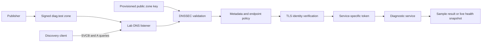

# Evaluator guide — DiagDiscover / PS-033

**Team:** A3-PS033-TC378<br>
**Submission snapshot:** 31 October 2026

This guide describes the implemented local prototype. Begin with the
[repository README](../README.md) for installation, the
[4:21 product demonstration](../demo/DiagDiscover-Product-Film-1080p.mp4?raw=true),
or the [Windows executable](../desktop/DiagDiscover.exe?raw=true).

The [Level 1 PDF](../A3-PS033-TC378-Level1.pdf) and
[PowerPoint](../A3-PS033-TC378-Level1.pptx) are the original proposal, rather than
an updated implementation report. The existing
[team introduction video](https://youtu.be/JQJZaydyBgI) is preserved separately.

## What the prototype demonstrates

The client starts with a logical diagnostic service name rather than a fixed
service port. A publisher creates signed records in `diag.test.`. The client
queries those records, validates their signatures and supported metadata, then
connects to the advertised endpoint over verified TLS with a separate token.

The discovery and invocation paths use actual DNS messages, cryptographic
signatures, network sockets, HTTPS and authentication. Diagnostic data has a
separate scope:

| Diagnostic mode | Result |
| --- | --- |
| Latency | Labelled sample round-trip time and packet-loss values |
| Traceroute | Labelled sample documentation-address hops |
| Health / sample | Labelled sample health fixture |
| Health / live | CPU activity over 250 ms, memory and uptime, with timestamp and provenance |

In JSON, sample responses have `mock: true` and live health has `mock: false`.
Live health is one observation from the service's host, not a continuous monitor
or a guarantee that a system is healthy.

## Architecture



`lab.py` contains the publisher, bounded DNS listener, HTTPS services and client.
`dns_inventory.py` adds a signed private PTR-to-SVCB catalogue. `diagnostics.py`
collects and validates live health. `dashboard.py` and the `web/` assets display
the workflow; `desktop_app.py` wraps that interface in a Windows application.

The trust anchor is provisioned locally before discovery. The client does not
learn a trusted key from an untrusted DNS answer. TLS trust and invocation
credentials are separate from DNS metadata. DNSSEC does not grant authorization
or prove a service's intentions. See [PROTOCOL.md](PROTOCOL.md) for the exact
record profile and its limitations.

## Five-minute review walkthrough

1. Launch the executable or start the browser/Docker version using the
   [README](../README.md). Open the laboratory.
2. Select **Browse DNS services**. Inspect health, latency and traceroute. The
   signed index and service metadata are checked, but there is no invocation.
   Catalogue endpoints are advertised examples, not running service listeners.
3. Select **System health**, **Live system health**, **Normal discovery**, then
   **Run discovery**. Six stages should pass: DNS signature, metadata, address,
   TLS identity, access token and response. Read the measurement timestamp and
   scope as well as the numbers.
4. Repeat with **Tampered DNS record**. The first stage fails; later stages do
   not run and no diagnostic request is sent.
5. Repeat with **Invalid service metadata**. The signature passes but metadata
   validation rejects the service profile before connection.
6. Repeat with **Wrong access token**. Discovery and TLS succeed, but the service
   refuses access. This demonstrates separation of discovery and authorization.
7. Select **All sample data** and run normal discovery to see the three original
   mock services. Use **Export run** for the actual per-run evidence.

Every dashboard run builds a fresh temporary lab with newly assigned local
ports and shuts it down after the result. Browse and run are separate operations;
a catalogue URL should not be treated as a persistent hosted service URL.

## Expected scenarios

Select a single service when reviewing an individual failure. In an all-service
run, some injected faults target one service while the others can still succeed.

| Dashboard scenario | CLI `--scenario` | Expected status | Boundary demonstrated |
| --- | --- | --- | --- |
| Normal discovery | `valid` | `SUCCESS` | All required checks and invocation succeed |
| Tampered DNS record | `bogus` | `DNSSEC_BOGUS` | Altered signed data is rejected |
| Invalid service metadata | `malformed` | `METADATA_INVALID` | Authentic metadata can still be unsupported |
| Service offline | `unavailable` | `SERVICE_UNAVAILABLE` | Valid discovery does not guarantee availability |
| Wrong access token | `unauthorized` | `AUTHENTICATION_DENIED` | Discovery does not confer access |
| Expired signatures | `expired` | `DNSSEC_BOGUS` | Expired signatures are rejected |
| Missing signatures | `unsigned` | `DNSSEC_UNVERIFIED` | Missing required proof blocks invocation |
| Untrusted TLS certificate | Dashboard only | `TLS_REJECTED` | TLS rejection occurs before sending credentials |

After creating the Python environment, run these commands from the repository
root. Replace `python` below with `.\.venv\Scripts\python.exe` on Windows or
`.venv/bin/python` on macOS/Linux:

```sh
python lab.py demo
python lab.py demo --service health --health-mode live
python lab.py demo --scenario bogus --service latency
python lab.py demo --scenario malformed --service latency
python lab.py demo --scenario unavailable --service latency
python lab.py demo --scenario unauthorized --service latency
python lab.py demo --scenario expired --service latency
python lab.py demo --scenario unsigned --service latency
```

Normal discovery exits with code 0. The negative demonstrations deliberately
exit with code 1 and their expected status; this does not mean installation failed.

To demonstrate endpoint movement between runs:

```sh
python lab.py demo --base-port 19443
```

The publisher advertises the new service ports and the unchanged client obtains
them through signed records. This demonstrates port changes between runs, not
live IP migration, DNS cache invalidation or TTL propagation.

## Reproducible checks

**Verified on 31 October 2026:** the local Python unittest suite completed with
**60 tests passed**. This reports the local run; consult GitHub Actions separately
for the status of any subsequently uploaded commit.

```sh
python -m pip install -r requirements-dev.txt
python -m ruff check .
python -m unittest discover -v
```

The tests exercise real local sockets and signatures as well as metadata rules,
authentication failures, the signed catalogue, health-response validation,
dashboard request handling and logging. Fixtures remain labelled as samples.
The [CI configuration](../.github/workflows/ci.yml) defines dependency checks,
lint, the test suite, a Docker build and tests inside the restricted container.

To reproduce the container test command after building:

```sh
docker compose build
docker compose run --rm --no-deps --entrypoint python lab -m unittest discover -v
```

## Docker and deployment boundaries

- The dashboard is available locally at `http://127.0.0.1:8766` after
  `docker compose up --build -d dashboard`; the source-run default is port 8765.
  These addresses refer to the evaluator's own computer, not a public website.
- The publisher, DNS listener, client and diagnostic services share one lab
  container. The default CLI container exposes no host ports.
- The container uses a nonroot user, a read-only image, temporary writable
  directories, dropped capabilities and bounded CPU, memory and process counts.
- Live health uses OS/VM counters visible to the service. Under Docker these
  need not match physical Windows Task Manager or container cgroup quotas.
- The prototype has one private zone and a provisioned trust anchor. It has no
  public DNSSEC root chain, arbitrary-network scanning, global registry, full
  DNS-AID interoperability or authenticated negative-answer validation.
- Generated runtime keys and tokens are not submitted. Fresh local execution
  provisions its own lab material. Do not publish generated `.runtime` contents.

Operational details, optional local dashboard HTTPS and production work that
remains are documented in [OPERATIONS.md](OPERATIONS.md). The supported record
subset and security assumptions are documented in [PROTOCOL.md](PROTOCOL.md).
